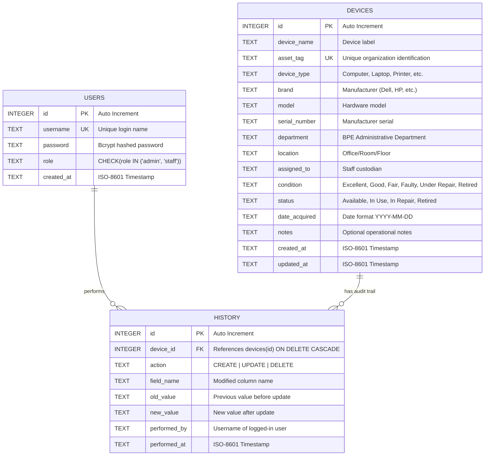

# Database Design & Schema Specification

This document details the relational data model for the **BPE ICT Office Device Tracking System**.

---

## 1. Entity-Relationship Diagram (ERD)



---

## 2. Table Specifications

### A. `users` Table
Stores authentication credentials and authorization roles for system operators.

| Column | Type | Constraints | Description |
|---|---|---|---|
| `id` | `INTEGER` | `PRIMARY KEY AUTOINCREMENT` | Unique identifier for each operator account |
| `username` | `TEXT` | `NOT NULL UNIQUE` | Unique username used for system login |
| `password` | `TEXT` | `NOT NULL` | One-way salted hash generated by bcrypt (10 rounds) |
| `role` | `TEXT` | `NOT NULL CHECK(role IN ('admin','staff'))` | Access level controlling system-wide permissions |
| `created_at` | `TEXT` | `NOT NULL DEFAULT (datetime('now'))` | UTC timestamp of account creation |

---

### B. `devices` Table
The primary inventory entity representing physical hardware assets owned by the Bureau.

| Column | Type | Constraints | Description |
|---|---|---|---|
| `id` | `INTEGER` | `PRIMARY KEY AUTOINCREMENT` | System primary key |
| `device_name` | `TEXT` | `NOT NULL` | Human-readable name (e.g. "ICT Manager Workstation") |
| `asset_tag` | `TEXT` | `NOT NULL UNIQUE` | Government asset tag (e.g. `BPE-ICT-001`) |
| `device_type` | `TEXT` | `NOT NULL` | Hardware classification (`Computer`, `Laptop`, `Printer`, etc.) |
| `brand` | `TEXT` | `NULLABLE` | Manufacturer name (e.g. `Dell`, `HP`, `Cisco`) |
| `model` | `TEXT` | `NULLABLE` | Model number or nomenclature (e.g. `OptiPlex 7090`) |
| `serial_number` | `TEXT` | `NULLABLE` | Hardware factory serial number |
| `department` | `TEXT` | `NOT NULL` | Department custodian of the hardware |
| `location` | `TEXT` | `NULLABLE` | Room number, floor, or physical workspace location |
| `assigned_to` | `TEXT` | `NULLABLE` | Full name of individual staff assignee or custodian |
| `condition` | `TEXT` | `NOT NULL DEFAULT 'Good'` | Physical integrity (`Excellent`, `Good`, `Fair`, `Faulty`, `Under Repair`, `Retired`) |
| `status` | `TEXT` | `NOT NULL DEFAULT 'Available'` | Operational readiness (`Available`, `In Use`, `In Repair`, `Retired`) |
| `date_acquired`| `TEXT` | `NULLABLE` | Date the device was acquired by the BPE |
| `notes` | `TEXT` | `NULLABLE` | Maintenance history or special operational notes |
| `created_at` | `TEXT` | `NOT NULL DEFAULT (datetime('now'))`| Timestamp when the record was cataloged |
| `updated_at` | `TEXT` | `NOT NULL DEFAULT (datetime('now'))`| Timestamp of the most recent modification |

---

### C. `history` Table
An append-only audit trail logging every administrative and operational change made to any device.

| Column | Type | Constraints | Description |
|---|---|---|---|
| `id` | `INTEGER` | `PRIMARY KEY AUTOINCREMENT` | Audit log record sequence number |
| `device_id` | `INTEGER` | `NOT NULL REFERENCES devices(id) ON DELETE CASCADE` | Target device reference |
| `action` | `TEXT` | `NOT NULL` | Action performed (`CREATE`, `UPDATE`, `DELETE`) |
| `field_name` | `TEXT` | `NULLABLE` | Specific attribute changed (e.g. `location`, `status`) |
| `old_value` | `TEXT` | `NULLABLE` | Value before modification |
| `new_value` | `TEXT` | `NULLABLE` | Value after modification |
| `performed_by`| `TEXT` | `NOT NULL` | Username of the operator who executed the change |
| `performed_at`| `TEXT` | `NOT NULL DEFAULT (datetime('now'))`| Precise UTC timestamp of the modification |

---

## 3. Referential Integrity & Performance Optimizations

1. **Foreign Key Enforcement:**
   SQLite requires explicit activation of foreign key constraints on every database connection. This is enforced in `backend/db.js` via:
   ```javascript
   db.pragma('foreign_keys = ON');
   ```
2. **Cascading Deletions:**
   When an administrator deletes a device from `devices`, all corresponding history records in `history` are automatically pruned by SQLite via the `ON DELETE CASCADE` rule.
3. **Write-Ahead Logging (WAL):**
   ```javascript
   db.pragma('journal_mode = WAL');
   ```
   WAL mode allows readers to read from the database without acquiring exclusive database locks, drastically reducing read-write contention.
4. **Parameterized Prepared Statements:**
   All operations use prepared statements (e.g. `db.prepare('SELECT ... WHERE id = ?')`), ensuring that query plans are precompiled and completely preventing SQL injection vulnerabilities.

---

## 4. Reset & Seeding Automation

The database initializes itself automatically whenever the application starts:
- If `backend/data/devices.db` does not exist, the `data/` directory and `.db` file are created automatically.
- Schema tables (`users`, `devices`, `history`) are created via `CREATE TABLE IF NOT EXISTS`.
- If the `devices` table has 0 rows, the system automatically inserts 20 pre-configured devices representing realistic assets across the Bureau's departments.
