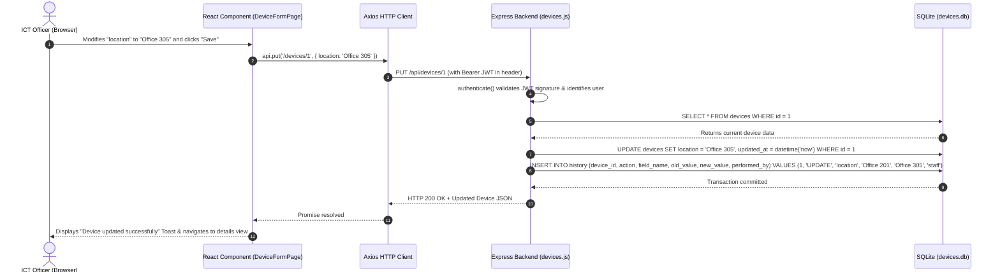

# System Architecture & Technical Specifications

This document provides a comprehensive technical overview of the **BPE ICT Office Device Tracking System**. It is structured to help software engineers, evaluators, and project defenders understand how the multi-tiered architecture functions.

---

## 1. High-Level Architecture Diagram

```
+-----------------------------------------------------------------------------------+
|                                  USER WORKSTATION                                 |
|                                                                                   |
|  [ Browser Client (Desktop / Tablet / Mobile) ]                                  |
|         |                                                                         |
|         |  HTTPS / HTTP Requests                                                  |
|         v                                                                         |
|  [ React 18 Single Page Application (SPA) ]                                       |
|     - React Router DOM (Declarative Client Routing)                               |
|     - AuthContext (Session State & Role Verification)                             |
|     - Axios Client (Automatic Bearer Token Interception)                          |
+---------|-------------------------------------------------------------------------+
          |
          |  REST API Requests (JSON / Multipart / Streams)
          v
+-----------------------------------------------------------------------------------+
|                                  BACKEND SERVER                                   |
|                                                                                   |
|  [ Express.js REST API Server (Node.js runtime) ]                                 |
|     |                                                                             |
|     +---> [ CORS Middleware ] (Validates origin: localhost & CLIENT_URL)          |
|     |                                                                             |
|     +---> [ Auth Middleware (authenticate) ] (Verifies signed JWT Bearer Token)   |
|     |                                                                             |
|     +---> [ Role Middleware (requireAdmin) ] (Blocks non-admin DELETE requests)   |
|     |                                                                             |
|     +---> [ Route Handlers ]                                                      |
|             ├── /api/auth    -> (Login, password verification via bcryptjs)       |
|             ├── /api/devices -> (CRUD, Search, Filters, Sorting, CSV Generation)  |
|             └── /api/health  -> (Uptime and health check telemetry)              |
+-------------|---------------------------------------------------------------------+
              |
              |  Direct Synchronous C++ Binding (better-sqlite3)
              v
+-----------------------------------------------------------------------------------+
|                                DATA PERSISTENCE LAYER                             |
|                                                                                   |
|  [ Embedded SQLite Database: backend/data/devices.db ]                            |
|     - Write-Ahead Logging (WAL) Mode enabled for high-concurrency reading         |
|     - Foreign Key constraints enforced (`ON DELETE CASCADE`)                     |
|     - Tables: `users`, `devices`, `history`                                       |
+-----------------------------------------------------------------------------------+
```

---

## 2. Frontend Layer (React 18 + Vite)

### Architecture Patterns Used
1. **Single-Page Application (SPA):** All user interactions occur without full browser page reloads. The application dynamically re-renders components based on URL routes handled client-side.
2. **Context API for Global Auth State:** The `AuthContext` provides a centralized state containing `{ user, token, isAdmin }`. This ensures any component can query authentication state without prop-drilling.
3. **Axios Interceptors Pattern:** Rather than manually attaching tokens in every HTTP request, a centralized Axios instance in `frontend/src/api.js` automatically attaches `Authorization: Bearer <token>` to all outgoing requests and catches `401 Unauthorized` responses to seamlessly redirect unauthenticated sessions to the login view.
4. **Vite Development Proxy:** During development, the frontend runs on port `5173` and forwards all `/api/*` calls to `http://localhost:5000`. This completely eliminates CORS issues during local engineering workflows.

---

## 3. Backend Layer (Node.js + Express.js)

### Design & Modularity
- **Decoupled Route Handling:** Authentication endpoints (`routes/auth.js`) are separated from hardware asset management (`routes/devices.js`).
- **Middleware Guard Pipeline:**
  ```text
  Incoming Request -> express.json() -> CORS Guard -> authenticate (JWT) -> Route Handler
                                                             │
                                                             └──> requireAdmin (Admin routes only)
  ```
- **Error Handling Pipeline:** A centralized error-handling middleware catches uncaught exceptions, preventing the Node.js server process from crashing and returning safe, non-leaking JSON error messages to the client.

---

## 4. Database Persistence Layer (SQLite & better-sqlite3)

### Why SQLite & better-sqlite3?
1. **Zero External Dependencies:** SQLite is a serverless, self-contained SQL database engine. It does not require hosting, configuring, or maintaining a separate database server process (such as PostgreSQL or MySQL).
2. **Deterministic Speed:** Unlike asynchronous database wrappers that introduce event-loop latency, `better-sqlite3` uses direct synchronous C++ bindings into SQLite, executing queries in microseconds.
3. **Embedded Portability:** The entire system's state resides in a single file (`backend/data/devices.db`). Moving or backing up the database requires simply copying this single file.
4. **WAL Mode Concurrency:** The database executes `PRAGMA journal_mode = WAL`. Write-Ahead Logging allows simultaneous reads while a write transaction is occurring.

---

## 5. Python Integration (ReportLab Engine)

### Role of Python in the Project
The project incorporates a Python script (`create_pdf.py`) utilizing **ReportLab 5.x** to generate high-fidelity, printable PDF documentation and user guides.

### Workflow:
1. **Document Modeling:** Python constructs a programmatic document flow containing custom `ParagraphStyle`, `Table`, and `HRFlowable` objects.
2. **Canvas Rendering:** ReportLab compiles the layout directly into vector PDF format (`BPE_Device_Tracker_Guide.pdf`) without needing an external browser engine.
3. **Use Case:** Provides an automated, reproducible method for ICT departments to print physical compliance manuals, quick-start guides, and handover documentation.

---

## 6. End-to-End Request Cycle Example: Updating a Device Location

To illustrate how the components communicate, here is the exact trace of what occurs when an officer moves a computer from "Office 201" to "Office 305":


